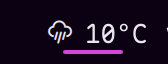

# MyWeather

Version 1.5.1

[English](README.md) | **Français**

Un widget compact pour la barre d'Omarchy : l'icône de la météo **et sa
température** dans la barre, avec un popup pour les conditions actuelles, les
prévisions sur cinq jours et un menu de réglages au clic droit.

MyWeather est un fork du widget météo intégré à Omarchy (`omarchy.weather`).
Ce qu'il ajoute :

- la température actuelle à droite de l'icône dans la barre (désactivable avec
  `showTemperature`) ;
- des prévisions jusqu'à **sept jours** au lieu de trois, avec un nombre de
  jours réglable de 0 à 7 et la probabilité de pluie sous chaque jour ;
- un **menu de réglages au clic droit** (français et anglais, selon la langue
  du bureau) pour choisir ce qu'affichent la barre et le panneau, et le lieu ;
- un **bouton roue dentée dans le panneau**, qui ouvre le même menu ;
- une **infobulle au survol** de la pastille, avec tous les relevés courants ;
- un `User-Agent` stable sur ses requêtes HTTP — le serveur d'open-meteo répond
  `403` à celui de `curl` par défaut, ce qui laissait la pastille sans icône et
  donc invisible ;
- une pastille qui reste visible quand open-meteo est injoignable, en reprenant
  l'icône de wttr.in.

Dépôt : <https://github.com/jotenakis2/MyWeather>

Sur la place de marché Omarchy :
<https://plugins.omarchy.org/plugin.html?id=io.github.jotenakis2.myweather>.
Une étoile sur GitHub et un cœur là-bas, c'est ce qui aide les autres à le
découvrir.

## Captures




## Installation

```bash
omarchy plugin add https://github.com/jotenakis2/MyWeather.git --enable
```

Le widget arrive par défaut dans la section `centerEnd`. Pour le placer
explicitement :

```bash
omarchy bar move io.github.jotenakis2.myweather --section left
```

Sections possibles : `left`, `centerBegin`, `center`, `centerEnd`, `right`.

## Ce qu'il affiche

Dans la barre : l'icône des conditions, suivie de la température actuelle.

Dans le popup :

| Ligne | Valeur |
| --- | --- |
| En-tête | grande icône, température actuelle, unité |
| Lieu | le lieu configuré, ou celui détecté depuis le réseau |
| Détails | ressenti, vent, humidité, probabilité de pluie |
| Prévisions | 0 à 7 jours : nom du jour, icône, max/min et probabilité de pluie |
| Pied | heure du dernier relevé, et une roue dentée des réglages |

Survoler la pastille affiche une infobulle avec tout à la fois, sous forme de
tableau aligné (la police de la barre est monospace et chaque ligne est
complétée à la même largeur, l'infobulle centrée garde donc la colonne droite) :

```
Colleville-Montgomery
Temp.       10°C
Ressenti     9°C
Vent      5 km/h
Humidité     90%
Pluie        30%
Mis à jour 18:11
```

Un clic sur la ligne du lieu ouvre la page de ce lieu sur **wttr.in** dans une
fenêtre de webapp flottante et centrée (réutilisée si elle est déjà ouverte).
Le menu de réglages a une section **Lieu** pour choisir une autre ville
(géocodage Open-Meteo) ou revenir au lieu détecté automatiquement par
`geo.omarchy.org` (le défaut).

## Clics

| Bouton | Action |
| --- | --- |
| Gauche | ouvrir ou fermer le popup |
| Droit | ouvrir le menu de réglages |
| Milieu | rafraîchir maintenant |
| Roue dentée (dans le panneau) | ouvrir le menu de réglages |

Le menu peut aussi s'ouvrir depuis un raccourci clavier ou un script :

```bash
omarchy-shell omarchy.weather settings
```

## Réglages

Un clic droit sur la pastille (ou sur la roue dentée du panneau) ouvre le menu.
Il suit la langue du bureau (les catalogues français et anglais sont livrés
avec le plugin) et s'organise en trois sections :

1. **Lieu** : détection automatique (par défaut) ou ville choisie par recherche ;
2. **Réglages barre** : température et icône des conditions dans la pastille ;
3. **Réglages panneau** : les relevés du panneau et le nombre de jours de prévisions.

Les valeurs barre/panneau sont écrites dans l'entrée du widget dans
`~/.config/omarchy/shell.json` :

| Clé | Défaut | Signification |
| --- | --- | --- |
| `showTemperature` | `true` | température à droite de l'icône dans la barre |
| `showIcon` | `true` | icône des conditions dans la barre |
| `showFeelsLike` | `true` | température ressentie dans le panneau |
| `showWind` | `true` | vent dans le panneau |
| `showHumidity` | `true` | humidité dans le panneau |
| `showRain` | `true` | probabilité de pluie dans le panneau |
| `showLocation` | `true` | nom du lieu dans le panneau |
| `showUpdatedAt` | `true` | heure de mise à jour en pied de panneau |
| `forecastDays` | `5` | jours de prévisions, 0 à 7 (0 masque la ligne) ; réglage panneau |
| `unit` | `""` | `""` automatique (pays, puis locale), ou `metric` / `imperial` |
| `refreshMinutes` | `15` | intervalle de rafraîchissement en minutes (minimum 1) |

La pastille garde toujours au moins l'icône ou la température : le menu refuse
de désactiver la dernière des deux.

Les mêmes valeurs se règlent en ligne de commande :

```bash
omarchy bar set io.github.jotenakis2.myweather showTemperature false --json
omarchy bar set io.github.jotenakis2.myweather forecastDays 2 --json
```

## D'où viennent les données

- `wttr.in` pour les conditions actuelles et les prévisions de secours (son
  `chanceofrain` remplit les mêmes lignes de pluie) ;
- `api.open-meteo.com` pour la lecture rapide des conditions, les prévisions
  quotidiennes, la pluie courante (`current=precipitation_probability`) et
  celle de chaque jour (`precipitation_probability_max`) ;
- `geo.omarchy.org` pour détecter le lieu quand aucun n'est configuré ;
- `geocoding-api.open-meteo.com` pour la recherche de lieu.

Le lieu configuré est conservé dans
`~/.local/state/omarchy/settings/weather.json` par `omarchy-weather-location` ;
le widget ne fait que lire ce fichier et laisse la CLI l'écrire. Aucune
télémétrie, aucun processus en arrière-plan : les requêtes sont faites par le
widget à l'ouverture et au rythme du minuteur de rafraîchissement.

## Licence

MIT. Le widget est un fork du plugin météo d'Omarchy
(© David Heinemeier Hansson) ; les modifications sont © 2026 Jotenakis.
Voir [LICENSE](LICENSE).
