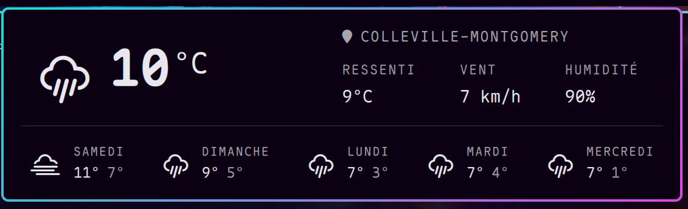

# MyWeather

Version 1.0.0

[English](README.md) | **Français**

Un widget compact pour la barre d'Omarchy : l'icône de la météo **et sa
température** dans la barre, avec un popup pour les conditions actuelles et les
prévisions sur cinq jours.

MyWeather est un fork du widget météo intégré à Omarchy (`omarchy.weather`).
Ce qu'il ajoute :

- la température actuelle à droite de l'icône dans la barre (désactivable avec
  `showTemperature`) ;
- des prévisions sur **cinq jours** au lieu de trois ;
- un `User-Agent` stable sur ses requêtes HTTP — le serveur d'open-meteo répond
  `403` à celui de `curl` par défaut, ce qui laissait la pastille sans icône et
  donc invisible ;
- une pastille qui reste visible quand open-meteo est injoignable, en reprenant
  l'icône de wttr.in.

Dépôt : <https://github.com/jotenakis2/MyWeather>

Sur la place de marché Omarchy :
<https://plugins.omarchy.org/plugin.html?id=io.github.jotenakis2.myweather>.
Une étoile sur GitHub et un cœur là-bas, c'est ce qui aide les autres à le
découvrir.

## Captures




## Installation

```bash
omarchy plugin add https://github.com/jotenakis2/MyWeather.git --enable
```

Le widget arrive par défaut dans la section `centerEnd`. Pour le placer
explicitement :

```bash
omarchy bar move io.github.jotenakis2.myweather --section left
```

Sections possibles : `left`, `centerBegin`, `center`, `centerEnd`, `right`.

## Ce qu'il affiche

Dans la barre : l'icône des conditions, suivie de la température actuelle.

Dans le popup :

| Ligne | Valeur |
| --- | --- |
| En-tête | grande icône, température actuelle, unité |
| Lieu | le lieu configuré, ou celui détecté depuis le réseau |
| Détails | ressenti, vent, humidité |
| Prévisions | cinq jours : nom du jour, icône, maximum et minimum |

Un clic sur la ligne du lieu ouvre un champ de recherche (géocodage
Open-Meteo). Choisir une suggestion enregistre le nom et les coordonnées ; une
valeur vide revient au lieu détecté automatiquement par `geo.omarchy.org`.

## Clics

| Bouton | Action |
| --- | --- |
| Gauche | ouvrir ou fermer le popup |
| Droit | envoyer le résumé météo en notification |
| Milieu | rafraîchir maintenant |

## Réglages

Options par widget, enregistrées dans `~/.config/omarchy/shell.json` dans
l'entrée du widget (le panneau de réglages de la barre les écrit) :

| Clé | Défaut | Signification |
| --- | --- | --- |
| `showTemperature` | `true` | afficher la température à droite de l'icône dans la barre |
| `unit` | `""` | `""` automatique (pays, puis locale), ou `metric` / `imperial` |
| `refreshMinutes` | `15` | intervalle de rafraîchissement en minutes (minimum 1) |

Exemple :

```bash
omarchy bar set io.github.jotenakis2.myweather showTemperature false --json
```

## D'où viennent les données

- `wttr.in` pour les conditions actuelles et les prévisions de secours ;
- `api.open-meteo.com` pour la lecture rapide des conditions et les prévisions
  quotidiennes ;
- `geo.omarchy.org` pour détecter le lieu quand aucun n'est configuré ;
- `geocoding-api.open-meteo.com` pour la recherche de lieu.

Le lieu configuré est conservé dans
`~/.local/state/omarchy/settings/weather.json` par `omarchy-weather-location` ;
le widget ne fait que lire ce fichier et laisse la CLI l'écrire. Aucune
télémétrie, aucun processus en arrière-plan : les requêtes sont faites par le
widget à l'ouverture et au rythme du minuteur de rafraîchissement.

## Licence

MIT. Le widget est un fork du plugin météo d'Omarchy
(© David Heinemeier Hansson) ; les modifications sont © 2026 Jotenakis.
Voir [LICENSE](LICENSE).
