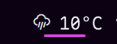
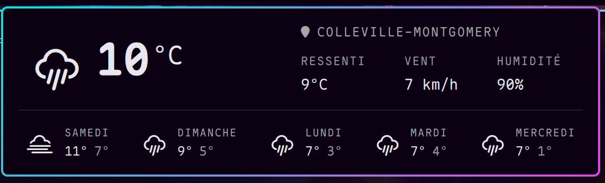
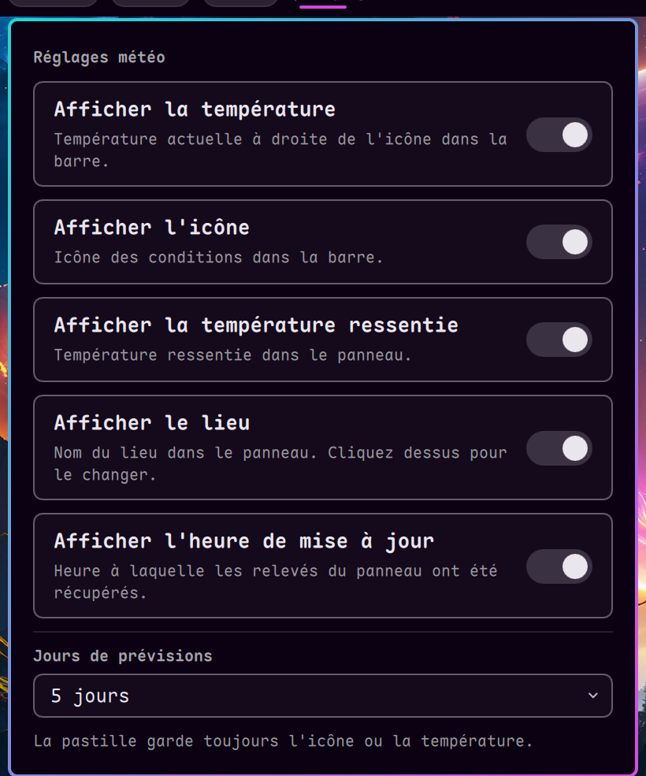

# MyWeather

Version 1.1.0

**English** | [Français](README-fr.md)

A compact Omarchy bar widget: the current condition icon **and its temperature**
in the bar, with a popup for current conditions and a five-day forecast, and a
right-click settings menu.

MyWeather is a fork of Omarchy's built-in weather widget (`omarchy.weather`).
What it adds on top:

- the current temperature next to the condition icon in the bar
  (switch it off with `showTemperature`);
- a **five-day** forecast instead of three, and a day count from 0 to 5;
- a **right-click settings menu** (English and French, following the desktop
  language) for what the bar and the popup show;
- a stable `User-Agent` on its HTTP requests — open-meteo's edge answers
  `403` to `curl`'s default one, which used to leave the pill without an icon
  and therefore invisible;
- a pill that stays visible when open-meteo is unreachable, by filling the
  empty icon from wttr.in.

Repository: <https://github.com/jotenakis2/MyWeather>

On the Omarchy plugin marketplace:
<https://plugins.omarchy.org/plugin.html?id=io.github.jotenakis2.myweather>.
A star on GitHub and a heart there are what help other people find it.

## Screenshots







## Install

```bash
omarchy plugin add https://github.com/jotenakis2/MyWeather.git --enable
```

The widget lands in the bar's `centerEnd` by default. To place it explicitly:

```bash
omarchy bar move io.github.jotenakis2.myweather --section left
```

Use `left`, `centerBegin`, `center`, `centerEnd` or `right`.

## What it shows

In the bar: the condition icon followed by the current temperature.

In the popup:

| Row | Value |
| --- | --- |
| Hero | big condition icon, current temperature, unit |
| Location | the configured place, or the one detected from your network |
| Stats | feels-like, wind, humidity |
| Forecast | 0 to 5 days: day name, condition icon, high and low |
| Footer | when the readings were last fetched |

Clicking the location line opens a search field (Open-Meteo geocoding). Picking
a suggestion stores the name and coordinates; an empty value returns to the
automatic location detected by `geo.omarchy.org`.

## Clicks

| Button | Action |
| --- | --- |
| Left | open or close the popup |
| Right | open the settings menu |
| Middle | refresh now |

The menu can also be opened from a keybinding or a script:

```bash
omarchy-shell omarchy.weather settings
```

## Settings

Right-clicking the pill opens the settings menu. It follows the desktop
language (English and French catalogs ship with the plugin) and writes the
chosen values straight into this widget's entry in
`~/.config/omarchy/shell.json`:

| Key | Default | Meaning |
| --- | --- | --- |
| `showTemperature` | `true` | temperature next to the icon in the bar |
| `showIcon` | `true` | condition icon in the bar |
| `showFeelsLike` | `true` | feels-like value in the popup |
| `showLocation` | `true` | place name in the popup |
| `showUpdatedAt` | `true` | last-update footer in the popup |
| `forecastDays` | `5` | days in the forecast row, 0 to 5 (0 hides it) |
| `unit` | `""` | `""` automatic (country, then locale), or `metric` / `imperial` |
| `refreshMinutes` | `15` | refresh interval in minutes (minimum 1) |

The bar pill always keeps at least the icon or the temperature: the menu
refuses to switch off the last one.

The same values can be set from the command line:

```bash
omarchy bar set io.github.jotenakis2.myweather showTemperature false --json
omarchy bar set io.github.jotenakis2.myweather forecastDays 2 --json
```

## Where the data comes from

- `wttr.in` for the current conditions and the popup's fallback forecast;
- `api.open-meteo.com` for the fast current reading and the daily forecast;
- `geo.omarchy.org` to detect the location when none is configured;
- `geocoding-api.open-meteo.com` for the location search.

The configured location is kept in
`~/.local/state/omarchy/settings/weather.json` by `omarchy-weather-location`;
the widget only reads that file and lets the CLI write it. No telemetry, no
background process: requests are made by the widget itself on open and on the
refresh timer.

## License

MIT. The widget is a fork of Omarchy's weather plugin
(© David Heinemeier Hansson); the modifications are © 2026 Jotenakis.
See [LICENSE](LICENSE).
